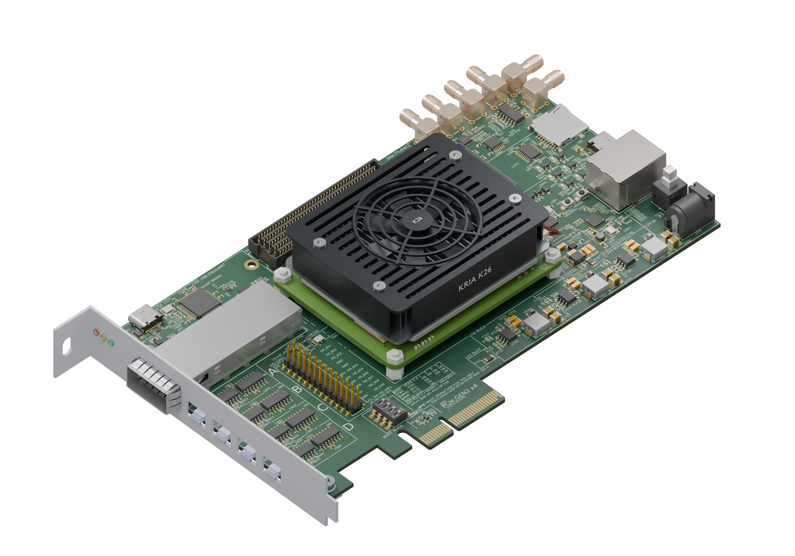
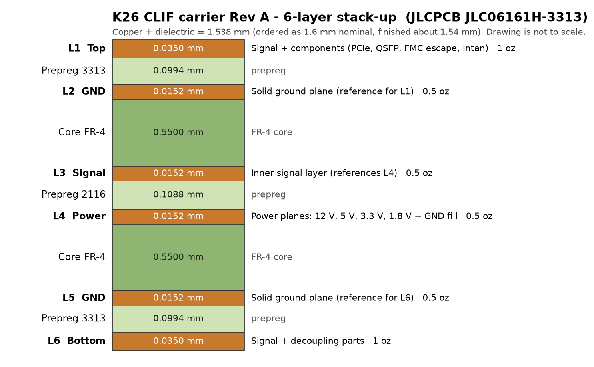

# K26 Closed-Loop Intan Front End — carrier board, Rev A

Carrier board for the AMD Kria K26 SOM: PCIe x4 edge connector, QSFP28 cage, FMC HPC connector,
four Intan RHD headstage ports, Gigabit Ethernet, USB, SD card and a USB JTAG/UART bridge.

## How to open the design

The design was made in **EasyEDA Pro** (Chinese name: 嘉立创EDA专业版), version 4.1.97.
A converted **KiCad** copy of the PCB is included as well.

### EasyEDA Pro (original, schematic + PCB)

File: **`design/easyeda/K26_CLIF_RevA.epro2`**

1. Get EasyEDA Pro. It is free.
   - Web version, nothing to install: <https://pro.easyeda.com/editor>
   - Desktop version (Windows, macOS, Linux): <https://easyeda.com/page/download>
2. In the editor choose **File → Import → EasyEDA (Professional)** and select the `.epro2` file.
3. The project opens with the schematic (12 pages) and the 6-layer PCB.

This file is the reference. It contains the schematic, the PCB, the footprints and the design rules.

### KiCad (converted copy, PCB only)

File: **`design/kicad/K26_CLIF_RevA.kicad_pro`** (open with KiCad 10 or newer)

- It contains the PCB: all six copper layers, tracks, vias, copper pours, silkscreen and the board outline.
- It does not contain the schematic.
- The EasyEDA design rules are not carried over, so the KiCad design rule check reports false errors. Use this copy for viewing and measuring.
- Do not press "Fill all zones" (key B). The copper pours are stored as exported from EasyEDA, and KiCad would fill them differently.

### No software

| What | Where |
|---|---|
| Every layer as PDF, one file per layer | [`docs/layers/`](docs/layers/) |
| All layers in one PDF (12 pages) | [`docs/K26_CLIF_RevA_all_layers.pdf`](docs/K26_CLIF_RevA_all_layers.pdf) |
| Schematic pages as pictures | [`schematic/`](schematic/) |
| Board pictures | [`docs/`](docs/) |
| Gerber files (open with any Gerber viewer) | [`fabrication/K26_CLIF_RevA_Gerber.zip`](fabrication/K26_CLIF_RevA_Gerber.zip) |

The layer PDFs are drawn from the Gerber files, so they show exactly what is sent to the board house.
Pages: L1 top copper, L2 ground, L3 signal, L4 power, L5 ground, L6 bottom copper, top and bottom silkscreen,
top and bottom solder mask openings, top and bottom paste. The bottom-side layers are drawn as seen from the top (not mirrored).

## Stack-up

Six layers, JLCPCB stack-up **JLC06161H-3313**, ordered as 1.6 mm (finished about 1.54 mm).

| Layer | Use | Copper |
|---|---|---|
| L1 Top | Signals and components | 1 oz |
| L2 | Ground plane | 0.5 oz |
| L3 | Inner signals | 0.5 oz |
| L4 | Power planes (12 V, 5 V, 3.3 V, 1.8 V) with ground fill | 0.5 oz |
| L5 | Ground plane | 0.5 oz |
| L6 Bottom | Signals and decoupling parts | 1 oz |

Dielectric between layers: L1–L2 prepreg 3313, 0.0994 mm; L2–L3 core, 0.55 mm; L3–L4 prepreg 2116,
0.1088 mm; L4–L5 core, 0.55 mm; L5–L6 prepreg 3313, 0.0994 mm.

L3 is much closer to L4 than to L2, so the L3 tracks use L4 as their reference plane.

## Fabrication settings used for the JLCPCB quote

- 6 layers, 1.6 mm, stack-up JLC06161H-3313
- Surface finish ENIG, 1 U"
- Vias epoxy filled and capped
- Gold fingers with 30° bevel (PCIe edge)
- Minimum track and gap 0.09 mm
- Assembly on both sides

## Folder contents

| Folder | Contents |
|---|---|
| `design/easyeda/` | EasyEDA Pro project file (original) |
| `design/kicad/` | KiCad 10 copy of the PCB |
| `fabrication/` | Gerber and drill files, BOM and pick-and-place files in JLCPCB format, polarity table, assembly drawings |
| `schematic/` | The 12 schematic pages as PNG |
| `docs/` | Layer PDFs, board renders and the stack-up drawing |

## Notes

- The `.epro2` file is the reference. The Gerber, BOM and pick-and-place files were exported from it.
- The schematic pictures of pages 01 (power), 05 (Ethernet) and 09 (FMC) are slightly older than the
  project file. They do not show the last small changes: the power test jumper JP701 with R741,
  the 4.7 µF Ethernet PHY reset capacitor, and FMC pins G8, G20 and G35 tied to ground.
- The two SOM connectors, the FMC connector and the Intan connectors are not in the assembly BOM.
  They are fitted by hand.
- The board has not been built or tested yet.
